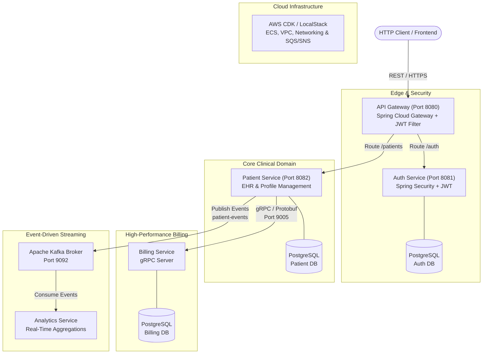

# PulseHealth Platform

[](https://www.oracle.com/java/)
[](https://spring.io/projects/spring-boot)
[](https://spring.io/projects/spring-cloud)
[](https://grpc.io/)
[](https://kafka.apache.org/)
[](https://www.postgresql.org/)
[](https://www.docker.com/)
[](https://aws.amazon.com/cdk/)

An enterprise-grade, event-driven distributed healthcare platform designed for high availability, fault isolation, and low-latency inter-service communication. PulseHealth manages the complete patient clinical lifecycle—from authentication and Electronic Health Records (EHR) to high-speed billing processing and real-time streaming analytics.

---

## Architecture Overview



---

## Core Services & Responsibilities

| Service | Protocol / Port | Technology | Purpose |
| :--- | :--- | :--- | :--- |
| **`api-gateway`** | HTTP / `8080` | Spring Cloud Gateway | Central entry point, request routing, header manipulation, and JWT token validation. |
| **`auth-service`** | HTTP / `8081` | Spring Boot, Spring Security, JJWT | User registration, authentication, credential validation, and stateless JWT token issuance. |
| **`patient-service`** | HTTP / `8082` | Spring Boot, Spring Data JPA, Kafka Producer | Manages patient medical profiles, diagnoses, and emits domain change events. |
| **`billing-service`** | gRPC / `9005` | gRPC, Protobuf, Netty | High-performance binary RPC server handling patient billing accounts and transaction processing. |
| **`analytics-service`**| Kafka Consumer | Spring Kafka, Protobuf Deserializer | Listens asynchronously to Kafka event streams for clinical data aggregation and metrics. |
| **`infrastructure`** | IaC (AWS CDK) | AWS CDK Java, LocalStack | Cloud Infrastructure as Code defining container orchestration and cloud resource stacks. |
| **`integration-tests`**| Test Suite | REST Assured, JUnit 5 | End-to-end integration and API contract verification suite across services. |

---

## Key Architectural & Technical Highlights

1. **Dual-Protocol Communication**:
   - **RESTful APIs** exposed at the edge through Spring Cloud Gateway for external clients.
   - **gRPC + Protocol Buffers** internally between `patient-service` and `billing-service` for ultra-low latency, strongly typed contracts, and reduced binary serialization overhead.

2. **Event-Driven Architecture**:
   - Decoupled asynchronous processing powered by **Apache Kafka**.
   - Patient admission, update, and discharge events are published to Kafka topics, consumed independently by the `analytics-service` without impacting core transactional flows.

3. **Database-Per-Service Isolation**:
   - Strict microservice boundaries with independent **PostgreSQL** database schemas for `auth`, `patient`, and `billing`, preventing domain coupling and shared locks.

4. **Zero-Trust Token-Based Security**:
   - Stateless **JWT (JSON Web Token)** authentication enforced at the API Gateway and Auth Service, featuring BCrypt password hashing and Role-Based Access Control (RBAC).

5. **Cloud-Ready Infrastructure as Code (IaC)**:
   - Fully automated AWS infrastructure provisioning defined using **AWS CDK in Java** and tested locally against **LocalStack**.

---

## Repository Structure

```
pulse-health-platform/
├── api-gateway/           # Spring Cloud Gateway routing & edge security
├── auth-service/          # Spring Security & JWT authentication service
├── patient-service/       # Patient clinical management service (REST + Kafka + gRPC client)
├── billing-service/       # Billing engine (gRPC server with Protobuf contracts)
├── analytics-service/     # Real-time event consumer & streaming analytics
├── api-requests/          # HTTP request collections for API testing
├── grpc-requests/         # gRPC request schemas and test payloads
├── infrastructure/        # AWS CDK Java definitions & LocalStack deployment scripts
├── integration-tests/     # End-to-end REST Assured test suite
└── pom.xml                # Multi-service parent POM configuration
```

---

## Getting Started

### Prerequisites
* **Java**: JDK 17 or higher
* **Maven**: 3.8+
* **Docker & Docker Compose**: For containerized databases and Kafka broker

### 1. Start Infrastructure Dependencies
Start PostgreSQL instances, Apache Kafka, and LocalStack:
```bash
# Start Docker environment
docker compose -f infrastructure/docker-compose.yml up -d
```

### 2. Build Services & Generate Protobuf Stubs
Compile all services and generate gRPC stubs from proto definitions:
```bash
mvn clean install -DskipTests
```

### 3. Run the Services
You can run each service independently using Maven:
```bash
# Terminal 1: Auth Service
mvn -pl auth-service spring-boot:run

# Terminal 2: Billing Service (gRPC)
mvn -pl billing-service spring-boot:run

# Terminal 3: Patient Service
mvn -pl patient-service spring-boot:run

# Terminal 4: Analytics Service
mvn -pl analytics-service spring-boot:run

# Terminal 5: API Gateway
mvn -pl api-gateway spring-boot:run
```

---

## API Endpoints & Testing

### Authentication
* `POST /auth/register` — Register a new healthcare worker / patient
* `POST /auth/login` — Authenticate and receive a signed JWT bearer token

### Patients (Routed via Gateway)
* `GET /patients` — Retrieve patient profiles (Protected with JWT)
* `POST /patients` — Register a new patient and trigger billing initialization via gRPC & Kafka event
* `GET /patients/{id}` — Fetch detailed clinical history

### Automated Integration Tests
Run the comprehensive REST Assured test suite:
```bash
mvn -pl integration-tests test
```

---

## License & Acknowledgments

- **Reference Architecture**: Architecture and implementation based on the microservices reference design by Chris Blakely (Code Jackal).
- **License**: Released under the MIT License.