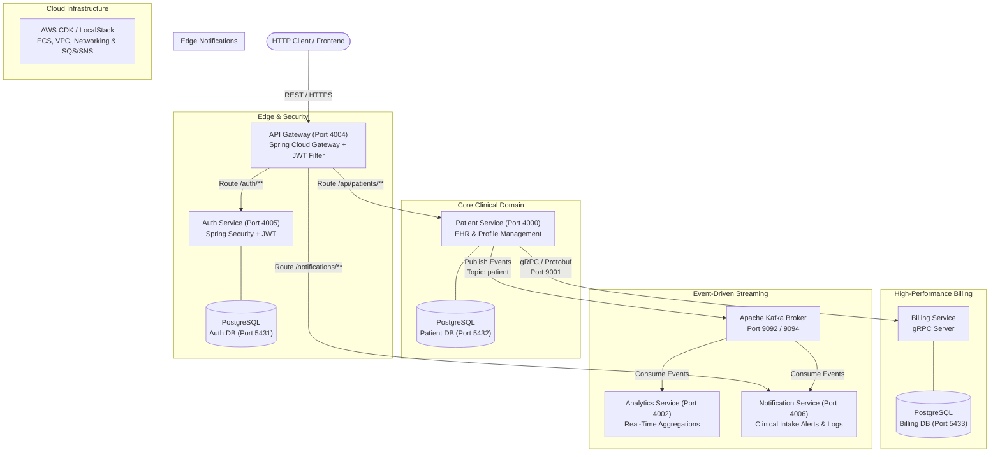

# PulseHealth Platform

[](https://www.oracle.com/java/)
[](https://spring.io/projects/spring-boot)
[](https://spring.io/projects/spring-cloud)
[](https://grpc.io/)
[](https://kafka.apache.org/)
[](https://www.postgresql.org/)
[](https://www.docker.com/)
[](https://github.com/Adarsh-Kumar-Sinha/pulse-health-platform/actions)

An enterprise-grade, event-driven distributed healthcare platform designed for high availability, fault isolation, and low-latency inter-service communication. PulseHealth manages the complete patient clinical lifecycle—from authentication and Electronic Health Records (EHR) to high-speed billing processing, real-time streaming analytics, and automated patient notifications.

---

## Architecture Overview



---

## Core Services & Responsibilities

| Service | Protocol / Port | Technology | Purpose |
| :--- | :--- | :--- | :--- |
| **`api-gateway`** | HTTP / `4004` | Spring Cloud Gateway | Central entry point, request routing, header manipulation, and JWT token validation. |
| **`auth-service`** | HTTP / `4005` | Spring Boot, Spring Security, JJWT | User registration, authentication, credential validation, and stateless JWT token issuance. |
| **`patient-service`** | HTTP / `4000` | Spring Boot, Spring Data JPA, Kafka Producer | Manages patient medical profiles, diagnoses, and emits domain change events. |
| **`billing-service`** | gRPC / `9001`, HTTP / `4001` | gRPC, Protobuf, Netty, Spring Boot | High-performance binary RPC server handling patient billing accounts and transaction processing. |
| **`analytics-service`**| HTTP / `4002`, Kafka Consumer | Spring Kafka, Protobuf Deserializer | Listens asynchronously to Kafka event streams for clinical data aggregation and metrics. |
| **`notification-service`**| HTTP / `4006`, Kafka Consumer | Spring Kafka, Protobuf, Actuator | Real-time event consumer dispatching automated patient alerts and clinical intake notifications. |
| **`infrastructure`** | IaC (AWS CDK) | AWS CDK Java, LocalStack | Cloud Infrastructure as Code defining container orchestration and cloud resource stacks. |
| **`integration-tests`**| Test Suite | REST Assured, JUnit 5 | End-to-end integration and API contract verification suite across services. |

---

## Key Architectural & Technical Highlights

1. **Dual-Protocol Communication**:
   - **RESTful APIs** exposed at the edge through Spring Cloud Gateway for external clients.
   - **gRPC + Protocol Buffers** internally between `patient-service` and `billing-service` for ultra-low latency, strongly typed contracts, and reduced binary serialization overhead.

2. **Event-Driven Architecture**:
   - Decoupled asynchronous processing powered by **Apache Kafka**.
   - Patient admission, update, and discharge events are published to the `patient` topic, consumed independently by both `analytics-service` and `notification-service` without impacting core transactional flows.

3. **Database-Per-Service Isolation**:
   - Strict microservice boundaries with independent **PostgreSQL** database schemas for `auth`, `patient`, and `billing`, preventing domain coupling and shared database locks.

4. **Zero-Trust Token-Based Security**:
   - Stateless **JWT (JSON Web Token)** authentication enforced at the API Gateway and Auth Service, featuring BCrypt password hashing and Role-Based Access Control (RBAC).

5. **Unified Docker Compose Orchestration & CI/CD**:
   - Single-command local environment launch running all databases, Kafka broker, and microservices.
   - Automated GitHub Actions CI pipeline running compilation, static checks, and unit tests on every push.

---

## Repository Structure

```
pulse-health-platform/
├── .github/workflows/     # GitHub Actions CI pipeline
├── api-gateway/           # Spring Cloud Gateway routing & edge security
├── auth-service/          # Spring Security & JWT authentication service
├── patient-service/       # Patient clinical management service (REST + Kafka + gRPC client)
├── billing-service/       # Billing engine (gRPC server with Protobuf contracts)
├── analytics-service/     # Real-time event consumer & streaming analytics
├── notification-service/  # Event consumer & automated clinical alert dispatcher
├── api-requests/          # HTTP request collections for API testing
├── grpc-requests/         # gRPC request schemas and test payloads
├── infrastructure/        # AWS CDK Java definitions & LocalStack deployment scripts
├── integration-tests/     # End-to-end REST Assured test suite
└── docker-compose.yml     # Complete Docker container orchestration
```

---

## Getting Started

### Prerequisites
* **Java**: JDK 21 or higher
* **Maven**: 3.9+
* **Docker & Docker Compose**

### 1. Run Everything via Docker Compose (Fastest)
Spin up the entire platform including databases, Kafka, and all microservices with one command:
```bash
docker compose up --build -d
```
Check container status:
```bash
docker compose ps
```

### 2. Or Run Locally via Maven

Start infrastructure dependencies (PostgreSQL databases & Kafka):
```bash
docker compose up -d auth-service-db patient-service-db billing-service-db zookeeper kafka
```

Build and run services individually:
```bash
# Terminal 1: Auth Service (Port 4005)
cd auth-service && mvn spring-boot:run

# Terminal 2: Billing Service (gRPC Port 9001, HTTP 4001)
cd billing-service && mvn spring-boot:run

# Terminal 3: Patient Service (Port 4000)
cd patient-service && mvn spring-boot:run

# Terminal 4: Analytics Service (Port 4002)
cd analytics-service && mvn spring-boot:run

# Terminal 5: Notification Service (Port 4006)
cd notification-service && mvn spring-boot:run

# Terminal 6: API Gateway (Port 4004)
cd api-gateway && mvn spring-boot:run
```

---

## API Endpoints & Verification

### Authentication (via Gateway Port 4004)
* `POST http://localhost:4004/auth/login` — Authenticate and receive a signed JWT bearer token
* `POST http://localhost:4004/auth/users` — Register a new user

### Patients (Protected with JWT)
* `GET http://localhost:4004/api/patients` — Retrieve patient profiles
* `POST http://localhost:4004/api/patients` — Register a new patient (Triggers gRPC billing initialization & Kafka domain events)
* `GET http://localhost:4004/api/patients/{id}` — Fetch detailed clinical history

### Notifications & Alerts
* `GET http://localhost:4004/notifications` — View dispatched clinical notification records
* `GET http://localhost:4004/notifications/status` — View notification service metrics and health status

### Automated Testing
Execute the full integration test suite:
```bash
cd integration-tests && mvn test
```

---

## License & Acknowledgments

- **Reference Architecture**: Based on the microservices reference design by Chris Blakely (Code Jackal).
- **Extensions & Enhancements**: Extended by Adarsh Kumar Sinha with automated Docker Compose orchestration, GitHub Actions CI/CD workflows, and an event-driven `notification-service`.
- **License**: Released under the [MIT License](LICENSE).